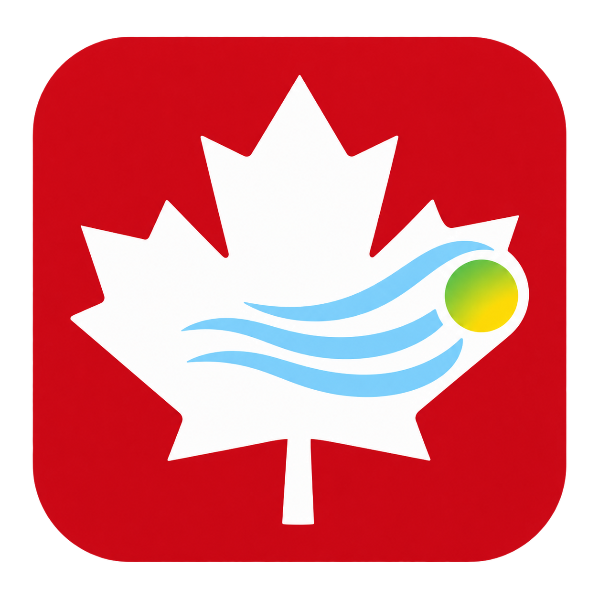

# Canadian Air Quality Index

### A simple Canadian-guidance-based indoor air quality integration for Home Assistant

  <strong>IAQCA keeps the familiar 1-65 Home Assistant air-quality score while using Canadian residential guidance where available.</strong>

Canadian Air Quality Index (IAQCA) evaluates configured live sensors in one room and exposes a numeric index plus a readable level. It is designed for practical home use: dashboards, ventilation control, source alerts, and automation conditions.

This is a maintained fork of [Limych/ha-iaquk](https://github.com/Limych/ha-iaquk). It preserves the upstream MIT license and credits the original project while converting the package, configuration flow, documentation, and guidance profile for Canada.

  <strong style="color: #41bdf5;">Scope:</strong> IAQCA is a simple home IAQ score, not an official Government of Canada index or a replacement for certified safety equipment. Carbon monoxide alarms and smoke alarms remain essential.

  <strong style="color: #41bdf5;">Canadian guidance:</strong> CO2, CO, NO2, formaldehyde, and radon use Canadian residential guidance. PM2.5, generic TVOC, VOC Index, temperature, and humidity remain practical live home signals for source detection, comfort, and ventilation.

## Installation

### HACS

1. Open **HACS** in Home Assistant.
2. Open the menu and choose **Custom repositories**.
3. Add <code>https://github.com/Wheemer/ha-iaqca</code> with category **Integration**.
4. Search for **Canadian Air Quality Index** and install it.
5. Restart Home Assistant.

### Manual install

1. Copy the repository's <code>custom_components/iaqca</code> folder to <code>&lt;config&gt;/custom_components/iaqca</code>.
2. Restart Home Assistant.

## Configure a Room

Use the Home Assistant integration UI:

1. Open **Settings > Devices & services**.
2. Select **Add integration**.
3. Search for **Canadian Air Quality Index**.
4. Give the room a name and select the sensor entities you want to use.

Each room creates these entities by default:

- <code>sensor.&lt;room&gt;_iaq_index</code>: 1-65, where higher is better.
- <code>sensor.&lt;room&gt;_iaq_level</code>: Excellent, Good, Fair, Poor, or Inadequate.

The index entity includes source values, source status, active issues, contributing source scores, and the active guidance profile as attributes.

## Supported Sources

| Source | Sensor unit |
| --- | --- |
| Temperature | C or F |
| Relative humidity | % |
| Carbon dioxide | ppm, ppb, mg/m3, or ug/m3 |
| Carbon monoxide | ppm, ppb, mg/m3, or ug/m3 |
| Nitrogen dioxide | ppm, ppb, mg/m3, or ug/m3 |
| Formaldehyde | ppm, ppb, mg/m3, or ug/m3 |
| Radon | Bq/m3 |
| PM | mg/m3 or ug/m3 |
| TVOC | ppm, ppb, mg/m3, or ug/m3 |
| VOC Index | unitless sensor index |

Only one of TVOC or VOC Index can be configured for a room. CO and PM accept one entity or a comma-separated list of entities.

## YAML Import and Migration

UI configuration is the recommended setup path. Existing YAML configuration using the <code>iaqca:</code> key is imported into config entries after Home Assistant starts.

The legacy <code>iaquk:</code> YAML key is also imported one-way for migration compatibility. It is deprecated; update it to <code>iaqca:</code> after confirming the imported room appears correctly.

~~~yaml
iaqca:
  kitchen:
    name: Kitchen
    sources:
      temperature: sensor.hood_air_temperature
      humidity: sensor.hood_air_humidity
      co2: sensor.hood_air_carbon_dioxide
      tvoc: sensor.hood_air_volatile_organic_compounds
      pm:
        - sensor.hood_air_pm2_5
~~~

## Simple Canadian Guidance Profile

IAQCA intentionally stays lightweight. It uses the configured sensor states directly and does not require an outdoor monitor, a separate database, or additional helper entities.

- Canadian residential guidance is applied where a direct contaminant guideline exists.
- PM2.5 and VOC readings remain useful operational signals for cooking, smoke, ventilation, and source events.
- The score is suitable for Home Assistant automations, but it is not a health diagnosis or regulatory compliance determination.

## Guidance References

IAQCA's simple profile is informed by Health Canada's residential indoor-air guidance:

- [Residential Indoor Air Quality Guidelines](https://www.canada.ca/en/health-canada/services/air-quality/residential-indoor-air-quality-guidelines.html)
- [Improve indoor air quality in your home](https://www.canada.ca/en/health-canada/services/air-quality/improve-indoor-air-quality-in-your-home.html)

## Troubleshooting

Enable integration debug logging:

~~~yaml
logger:
  logs:
    custom_components.iaqca: debug
~~~

Then restart Home Assistant and review **Settings > System > Logs**. The index attributes identify unavailable sources, invalid units, converted values, and active source issues.

## Upstream Credit

IAQCA is based on [Indoor Air Quality UK Index](https://github.com/Limych/ha-iaquk) by [Andrey Khrolenok (@Limych)](https://github.com/Limych). This fork retains the upstream MIT license and acknowledges the original project's architecture and foundation.

## License

MIT. See [LICENSE](LICENSE).
